# PD2AF 1.0 Specification, working copy

A copy of the [official specification](/specification/) (2 November 2026), to be changed here as our rules are
decided ([rules, draft](/pd2af/rules/)). The official page stays as it is.

[1. Identifying active entities](#1-identifying-active-entities)  
[2. Posttranslational modification (activation and deactivation)](#2-posttranslational-modification-activation-and-deactivation)  
[3. Metabolic reactions](#3-metabolic-reactions)  
[4. Empty set (production, degradation, transcription, translation)](#4-empty-set-production-degradation-transcription-translation)  
[5. Heterocomplex association and dissociation](#5-heterocomplex-association-and-dissociation)  
[6. Multimerisation](#6-multimerisation)  
[7. Translocation and transport](7-ranslocation-and-transport)  
[8. Hidden inhibition](#8-hidden-inhibition)  

This page offers the specification of the conversion rules. That includes identification of active entities and the translation of Process Description (PD) expressions to Activity Flow (AF) expressions. For each case we ensured that the converter translates exactly as shown: each left-hand diagram (PD) transforms into the corresponding right-hand diagram (AF).

Letter code used for human-readable rule identifiers: 
A - active; 
AS - association; 
AE - active entity; 
CURM - currency metabolites; 
CAT - catalysis; 
CATR - catalysis, reversible process; 
COMPL - complex; 
CONS - consumption; 
DEGR - degradation; 
DIS - dissociation; 
HIDINH - hidden inhibition; 
I - incactive; 
INH - inhibition; 
INHR - inhibition, reverisible process;
LO - logical operator; 
M - metabolite; 
MOD - modulation; 
MULT - multimerisation; 
N - named;
NCURM - noncurrency metabolites; 
NSTI - necessery stimulation; 
SS - empty set (source/sink); 
STI - stimulation; 
TRANS - transport;
TRSCR - transcription; 
TRSL - tranaslation.

Light green used to highlight _active entities_.

## 1. Identifying active entities

The following rules are used for identifying _active entities_ in the context of Process Description maps. Then, in other rules, the status of the entities _active_ vs. _inactive_ is used for adequate conversion. An entity is identified as _active_ if it is marked as "active" in a state variable, or has an outgoing regulatory arc (modulation, stimulation, catalysis, inhibition, necessery stimiulation), or has a consumption arc, or has a logic arc (input to a _logical operator_). 

In graphical visualisatin of these rules we use _unspecified entity_ to show that different types of entities can be in its place such as _macromolecule_ (protein), _simple chemical_ (metabolite), _nucleic acid feature_ (gene, mRNA) or _complex_.

<h4 style="color:black">1.1 PD2AF:AE-A</h4>

<table class="rules-table">
	<tr style="font-size:90%">
		<td style="width:400px; text-align:center;">
			
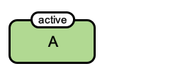

		</td>
		<td style="width:300px; text-align:center;">
		</td>
	</tr>
	<tr style="font-size:90%">
		<td style="width:400px; text-align:center;">
			<a href="/images/specification/ae-a/pd.gml">GML</a>
		</td>
		<td style="width:300px; text-align:center;">
		</td>
	</tr>
</table>

   <h4 style="color:black">1.2 PD2AF:AE-MOD</h4>
   
<table class="rules-table">
	<tr style="font-size:90%">
		<td style="width:400px; text-align:center;">
			
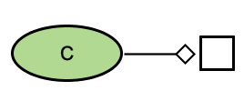

		</td>
		<td style="width:300px; text-align:center;">
		</td>
	</tr>
	<tr style="font-size:90%">
		<td style="width:400px; text-align:center;">
			<a href="/images/specification/ae-mod/pd.gml">GML</a>
		</td>
		<td style="width:300px; text-align:center;">
		</td>
	</tr>
</table>

   <h4 style="color:black">1.3 PD2AF:AE-STI</h4>

<table class="rules-table">
	<tr style="font-size:90%">
		<td style="width:400px; text-align:center;">
			
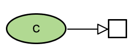

		</td>
		<td style="width:300px; text-align:center;">
		</td>
	</tr>
	<tr style="font-size:90%">
		<td style="width:400px; text-align:center;">
			<a href="/images/specification/ae-sti/pd.gml">GML</a>
		</td>
		<td style="width:300px; text-align:center;">
		</td>
	</tr>
</table>

   <h4 style="color:black">1.4 PD2AF:AE-CAT</h4>

<table class="rules-table">
	<tr style="font-size:90%">
		<td style="width:400px; text-align:center;">
			
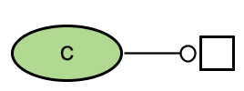

		</td>
		<td style="width:300px; text-align:center;">
		</td>
	</tr>
	<tr style="font-size:90%">
		<td style="width:400px; text-align:center;">
			<a href="/images/specification/ae-cat/pd.gml">GML</a>
		</td>
		<td style="width:300px; text-align:center;">
		</td>
	</tr>
</table>

   <h4 style="color:black">1.5 PD2AF:AE-INH</h4>

<table class="rules-table">
	<tr style="font-size:90%">
		<td style="width:400px; text-align:center;">
			

		</td>
		<td style="width:300px; text-align:center;">
		</td>
	</tr>
	<tr style="font-size:90%">
		<td style="width:400px; text-align:center;">
			<a href="/images/specification/ae-inh/pd.gml">GML</a>
		</td>
		<td style="width:300px; text-align:center;">
		</td>
	</tr>
</table>

   <h4 style="color:black">1.6 PD2AF:AE-NSTI</h4>

<table class="rules-table">
	<tr style="font-size:90%">
		<td style="width:400px; text-align:center;">
			
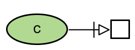

		</td>
		<td style="width:300px; text-align:center;">
		</td>
	</tr>
	<tr style="font-size:90%">
		<td style="width:400px; text-align:center;">
			<a href="/images/specification/ae-nsti/pd.gml">GML</a>
		</td>
		<td style="width:300px; text-align:center;">
		</td>
	</tr>
</table>

<h4 style="color:black">1.7 PD2AF:AE-LO (NEW)</h4>

<table class="rules-table">
	<tr style="font-size:90%">
		<td style="width:400px; text-align:center;">
			
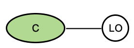

		</td>
		<td style="width:300px; text-align:center;">
		</td>
	</tr>
	<tr style="font-size:90%">
		<td style="width:400px; text-align:center;">
			<a href="/images/specification/ae-lo/pd.gml">GML</a>
		</td>
		<td style="width:300px; text-align:center;">
		</td>
	</tr>
</table>

<!--
<h4 style="color:black">1.8 PD2AF:AE-CONS (NEW)</h4>
<table class="rules-table">
	<tr style="font-size:90%">
		<td style="width:400px; text-align:center;">
			
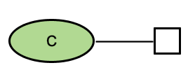

		</td>
		<td style="width:300px; text-align:center;">
		</td>
	</tr>
	<tr style="font-size:90%">
		<td style="width:400px; text-align:center;">
			<a href="/images/specification/ae-cons/pd.gml">GML</a>
		</td>
		<td style="width:300px; text-align:center;">
		</td>
	</tr>
</table>
-->

 

## 2. Posttranslational modification (activation and deactivation)

Associated terms: [SBO:0000182](https://identifiers.org/sbo/SBO:0000182) conversion, [GO:0036211](https://identifiers.org/quickgo/GO:0036211) protein modification process, [GO:0140096](https://identifiers.org/quickgo/GO:0140096) catalytic activity, acting on a protein

   <h4 style="color:black">2.1 PD2AF:I-STI-I</h4>

<table class="rules-table">
	<tr style="font-size:90%">
		<td style="width:400px; text-align:center;">
			
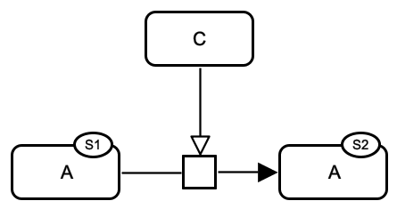

		</td>
		<td style="width:300px; text-align:center;">
			
		</td>
	</tr>
	<tr style="font-size:90%">
		<td style="width:400px; text-align:center;">
			<a href="/images/specification/i-sti-i/pd.sbgn">SBGN-ML</a>&ensp; &ensp;
			<a href="http://web.newteditor.org/?URL=https://www.pd2af.org//images/specification/i-sti-i/pd.sbgn" target="_blank">Newt</a>
		</td>
		<td style="width:300px; text-align:center;">
			<a href="/images/specification/i-sti-i/af.sbgn">SBGN-ML</a>&ensp; &ensp;
			<a href="http://web.newteditor.org/?URL=https://www.pd2af.org//images/specification/i-sti-i/af.sbgn" target="_blank">Newt</a>
		</td>
	</tr>
</table> 
	

   <h4 style="color:black">2.2 PD2AF:I-CAT-I</h4>

<table class="rules-table">
	<tr>
		<td style="width:300px; text-align:center;">
			
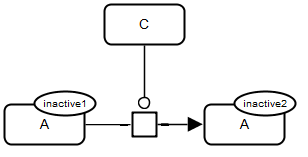

		</td>
		<td style="width:300px; text-align:center;">
			
		</td>
	</tr>
        <tr style="font-size:90%">
		<td style="width:400px; text-align:center;">
			<a href="/images/specification/i-cat-i/pd.sbgn">SBGN-ML</a>&ensp; &ensp;
			<a href="http://web.newteditor.org/?URL=https://www.pd2af.org//images/specification/i-cat-i/pd.sbgn" target="_blank">Newt</a>
		</td>
		<td style="width:300px; text-align:center;">
			<a href="/images/specification/i-cat-i/af.sbgn">SBGN-ML</a>&ensp; &ensp;
			<a href="http://web.newteditor.org/?URL=https://www.pd2af.org//images/specification/i-cat-i/af.sbgn" target="_blank">Newt</a>
		</td>
        </tr>
</table> 
	

   <h4 style="color:black">2.3 PD2AF:I-NSTI-I</h4>

<table class="rules-table">
	<tr style="font-size:90%">
		<td style="width:400px; text-align:center;">
			

		</td>
		<td style="width:300px; text-align:center;">
			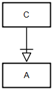
		</td>
	</tr>
	<tr style="font-size:90%">
		<td style="width:400px; text-align:center;">
			<a href="/images/specification/i-nsti-i/pd.sbgn">SBGN-ML</a>&ensp; &ensp;
			<a href="http://web.newteditor.org/?URL=https://www.pd2af.org//images/specification/i-nsti-i/pd.sbgn" target="_blank">Newt</a>
		</td>
		<td style="width:300px; text-align:center;">
			<a href="/images/specification/i-nsti-i/af.sbgn">SBGN-ML</a>&ensp; &ensp;
			<a href="http://web.newteditor.org/?URL=https://www.pd2af.org//images/specification/i-nsti-i/af.sbgn" target="_blank">Newt</a>
		</td>
	</tr>
</table> 

   <h4 style="color:black">2.4 PD2AF:I-MOD-I</h4>

<table class="rules-table">
	<tr style="font-size:90%">
		<td style="width:400px; text-align:center;">
			

		</td>
		<td style="width:300px; text-align:center;">
			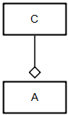
		</td>
	</tr>
	<tr style="font-size:90%">
		<td style="width:400px; text-align:center;">
			<a href="/images/specification/i-mod-i/pd.sbgn">SBGN-ML</a>&ensp; &ensp;
			<a href="http://web.newteditor.org/?URL=https://www.pd2af.org//images/specification/i-mod-i/pd.sbgn" target="_blank">Newt</a>
		</td>
		<td style="width:300px; text-align:center;">
			<a href="/images/specification/i-mod-i/af.sbgn">SBGN-ML</a>&ensp; &ensp;
			<a href="http://web.newteditor.org/?URL=https://www.pd2af.org//images/specification/i-mod-i/af.sbgn" target="_blank">Newt</a>
		</td>
	</tr>
</table> 
	

	

   <h4 style="color:black">2.5 PD2AF:I-INH-I</h4>

<table class="rules-table">
	<tr style="font-size:90%">
		<td style="width:400px; text-align:center;">
			
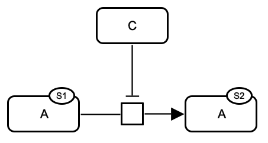

		</td>
		<td style="width:300px; text-align:center;">
			
		</td>
	</tr>
	<tr style="font-size:90%">
		<td style="width:400px; text-align:center;">
			<a href="/images/specification/i-inh-i/pd.sbgn">SBGN-ML</a>&ensp; &ensp;
			<a href="http://web.newteditor.org/?URL=https://www.pd2af.org//images/specification/i-inh-i/pd.sbgn" target="_blank">Newt</a>
		</td>
		<td style="width:300px; text-align:center;">
			<a href="/images/specification/i-inh-i/af.sbgn">SBGN-ML</a>&ensp; &ensp;
			<a href="http://web.newteditor.org/?URL=https://www.pd2af.org//images/specification/i-inh-i/af.sbgn" target="_blank">Newt</a>
		</td>
	</tr>
</table> 
	

   <h4 style="color:black">2.6 PD2AF:I-STI-A</h4>

<table class="rules-table">
	<tr style="font-size:90%">
		<td style="width:400px; text-align:center;">
			
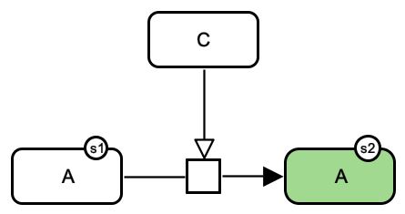

		</td>
		<td style="width:300px; text-align:center;">
			
		</td>
	</tr>
	<tr style="font-size:90%">
		<td style="width:400px; text-align:center;">
			<a href="/images/specification/i-sti-a/pd.gml">GML</a>&ensp; &ensp;
			<a href="/images/specification/i-sti-a/pd.sbgn">SBGN-ML</a>&ensp; &ensp;
			<a href="http://web.newteditor.org/?URL=https://www.pd2af.org//images/specification/i-sti-a/pd.sbgn" target="_blank">Newt</a>
		</td>
		<td style="width:300px; text-align:center;">
			<a href="/images/specification/i-sti-a/af.sbgn">SBGN-ML</a>&ensp; &ensp;
			<a href="http://web.newteditor.org/?URL=https://www.pd2af.org//images/specification/i-sti-a/af.sbgn" target="_blank">Newt</a>
		</td>
	</tr>
</table> 
	

   <h4 style="color:black">2.7 PD2AF:I-CAT-A</h4>

<table class="rules-table">
	<tr style="font-size:90%">
		<td style="width:400px; text-align:center;">
			

		</td>
		<td style="width:300px; text-align:center;">
			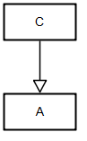
		</td>
	</tr>
	<tr style="font-size:90%">
		<td style="width:400px; text-align:center;">
			<a href="/images/specification/i-cat-a/pd.gml">GML</a>&ensp; &ensp;
			<a href="/images/specification/i-cat-a/pd.sbgn">SBGN-ML</a>&ensp; &ensp;
			<a href="http://web.newteditor.org/?URL=https://www.pd2af.org//images/specification/i-cat-a/pd.sbgn" target="_blank">Newt</a>
		</td>
		<td style="width:300px; text-align:center;">
			<a href="/images/specification/i-cat-a/af.sbgn">SBGN-ML</a>&ensp; &ensp;
			<a href="http://web.newteditor.org/?URL=https://www.pd2af.org//images/specification/i-cat-a/af.sbgn" target="_blank">Newt</a>
		</td>
	</tr>
</table> 

	
   <h4 style="color:black">2.8 PD2AF:I-NSTI-A</h4>
   
<!--WARNING: Rare or wrong representation of a signalling event.-->
WARNING: Rare or wrong representation of a signalling event.

<table class="rules-table">
	<tr style="font-size:90%">
		<td style="width:400px; text-align:center;">
			
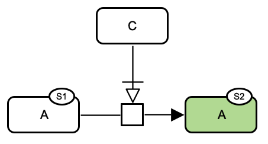

		</td>
		<td style="width:300px; text-align:center;">
			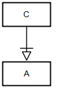
		</td>
	</tr>
	<tr style="font-size:90%">
		<td style="width:400px; text-align:center;">
			<a href="/images/specification/i-nsti-a/pd.gml">GML</a>&ensp; &ensp;
			<a href="/images/specification/i-nsti-a/pd.sbgn">SBGN-ML</a>&ensp; &ensp;
			<a href="http://web.newteditor.org/?URL=https://www.pd2af.org//images/specification/i-nsti-a/pd.sbgn" target="_blank">Newt</a>
		</td>
		<td style="width:300px; text-align:center;">
			<a href="/images/specification/i-nsti-a/af.sbgn">SBGN-ML</a>&ensp; &ensp;
			<a href="http://web.newteditor.org/?URL=https://www.pd2af.org//images/specification/i-nsti-a/af.sbgn" target="_blank">Newt</a>
		</td>
	</tr>
</table> 
	

   <h4 style="color:black">2.9 PD2AF:I-MOD-A</h4>

<table class="rules-table">
	<tr style="font-size:90%">
		<td style="width:400px; text-align:center;">
			

		</td>
		<td style="width:300px; text-align:center;">
			
		</td>
	</tr>
	<tr style="font-size:90%">
		<td style="width:400px; text-align:center;">
			<a href="/images/specification/i-mod-a/pd.gml">GML</a>&ensp; &ensp;
			<a href="/images/specification/i-mod-a/pd.sbgn">SBGN-ML</a>&ensp; &ensp;
			<a href="http://web.newteditor.org/?URL=https://www.pd2af.org//images/specification/i-mod-a/pd.sbgn" target="_blank">Newt</a>
		</td>
		<td style="width:300px; text-align:center;">
			<a href="/images/specification/i-mod-a/af.sbgn">SBGN-ML</a>&ensp; &ensp;
			<a href="http://web.newteditor.org/?URL=https://www.pd2af.org//images/specification/i-mod-a/af.sbgn" target="_blank">Newt</a>
		</td>
	</tr>
</table> 
	

   <h4 style="color:black">2.10 PD2AF:I-INH-A</h4>

<table class="rules-table">
	<tr style="font-size:90%">
		<td style="width:400px; text-align:center;">
			
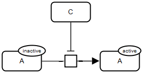

		</td>
		<td style="width:300px; text-align:center;">
			
		</td>
	</tr>
	<tr style="font-size:90%">
		<td style="width:400px; text-align:center;">
			<a href="/images/specification/i-inh-a/pd.gml">GML</a>&ensp; &ensp;
			<a href="/images/specification/i-inh-a/pd.sbgn">SBGN-ML</a>&ensp; &ensp;
			<a href="http://web.newteditor.org/?URL=https://www.pd2af.org//images/specification/i-inh-a/pd.sbgn" target="_blank">Newt</a>
		</td>
		<td style="width:300px; text-align:center;">
			<a href="/images/specification/i-inh-a/af.sbgn">SBGN-ML</a>&ensp; &ensp;
			<a href="http://web.newteditor.org/?URL=https://www.pd2af.org//images/specification/i-inh-a/af.sbgn" target="_blank">Newt</a>
		</td>
	</tr>
</table> 
	

   <h4 style="color:black">2.11 PD2AF:A-STI-I</h4>

<table class="rules-table">
	<tr style="font-size:90%">
		<td style="width:400px; text-align:center;">
			
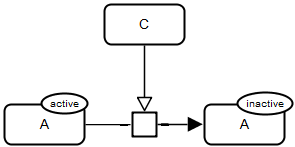

		</td>
		<td style="width:300px; text-align:center;">
			
		</td>
	</tr>
	<tr style="font-size:90%">
		<td style="width:400px; text-align:center;">
			<a href="/images/specification/a-sti-i/pd.gml">GML</a>&ensp; &ensp;
			<a href="/images/specification/a-sti-i/pd.sbgn">SBGN-ML</a>&ensp; &ensp;
			<a href="http://web.newteditor.org/?URL=https://www.pd2af.org//images/specification/a-sti-i/pd.sbgn" target="_blank">Newt</a>
		</td>
		<td style="width:300px; text-align:center;">
			<a href="/images/specification/a-sti-i/af.sbgn">SBGN-ML</a>&ensp; &ensp;
			<a href="http://web.newteditor.org/?URL=https://www.pd2af.org//images/specification/a-sti-i/af.sbgn" target="_blank">Newt</a>
		</td>
	</tr>
</table> 	
	

   <h4 style="color:black">2.12 PD2AF:A-CAT-I</h4>

<table class="rules-table">
	<tr style="font-size:90%">
		<td style="width:400px; text-align:center;">
			
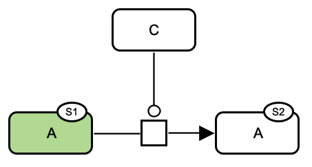

		</td>
		<td style="width:300px; text-align:center;">
			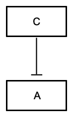
		</td>
	</tr>
	<tr style="font-size:90%">
		<td style="width:400px; text-align:center;">
			<a href="/images/specification/a-cat-i/pd.gml">GML</a>&ensp; &ensp;
			<a href="/images/specification/a-cat-i/pd.sbgn">SBGN-ML</a>&ensp; &ensp;
			<a href="http://web.newteditor.org/?URL=https://www.pd2af.org//images/specification/a-cat-i/pd.sbgn" target="_blank">Newt</a>
		</td>
		<td style="width:300px; text-align:center;">
			<a href="/images/specification/a-cat-i/af.sbgn">SBGN-ML</a>&ensp; &ensp;
			<a href="http://web.newteditor.org/?URL=https://www.pd2af.org//images/specification/a-cat-i/af.sbgn" target="_blank">Newt</a>
		</td>
	</tr>
</table> 
	

   <h4 style="color:black">2.13 PD2AF:A-NSTI-I
</h4>
   
<!--WARNING: Rare or wrong representation of a signalling event.-->
WARNING: Rare or wrong representation of a signalling event.

<table class="rules-table">
	<tr style="font-size:90%">
		<td style="width:400px; text-align:center;">
			
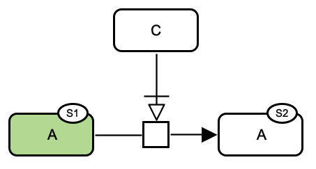

		</td>
		<td style="width:300px; text-align:center;">
			
		</td>
	</tr>
	<tr style="font-size:90%">
		<td style="width:400px; text-align:center;">
			<a href="/images/specification/a-nsti-i/pd.gml">GML</a>&ensp; &ensp;
			<a href="/images/specification/a-nsti-i/pd.sbgn">SBGN-ML</a>&ensp; &ensp;
			<a href="http://web.newteditor.org/?URL=https://www.pd2af.org//images/specification/a-nsti-i/pd.sbgn" target="_blank">Newt</a>
		</td>
		<td style="width:300px; text-align:center;">
			<a href="/images/specification/a-nsti-i/af.sbgn">SBGN-ML</a>&ensp; &ensp;
			<a href="http://web.newteditor.org/?URL=https://www.pd2af.org//images/specification/a-nsti-i/af.sbgn" target="_blank">Newt</a>
		</td>
	</tr>
</table> 

   <h4 style="color:black">2.14 PD2AF:A-MOD-I</h4>

<table class="rules-table">
	<tr style="font-size:90%">
		<td style="width:400px; text-align:center;">
			

		</td>
		<td style="width:300px; text-align:center;">
			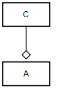
		</td>
	</tr>
	<tr style="font-size:90%">
		<td style="width:400px; text-align:center;">
			<a href="/images/specification/a-mod-i/pd.gml">GML</a>&ensp; &ensp;
			<a href="/images/specification/a-mod-i/pd.sbgn">SBGN-ML</a>&ensp; &ensp;
			<a href="http://web.newteditor.org/?URL=https://www.pd2af.org//images/specification/a-mod-i/pd.sbgn" target="_blank">Newt</a>
		</td>
		<td style="width:300px; text-align:center;">
			<a href="/images/specification/a-mod-i/af.sbgn">SBGN-ML</a>&ensp; &ensp;
			<a href="http://web.newteditor.org/?URL=https://www.pd2af.org//images/specification/a-mod-i/af.sbgn" target="_blank">Newt</a>
		</td>
	</tr>
</table> 

	

   <h4 style="color:black">2.15 PD2AF:A-INH-I</h4>

<table class="rules-table">
	<tr style="font-size:90%">
		<td style="width:400px; text-align:center;">
			
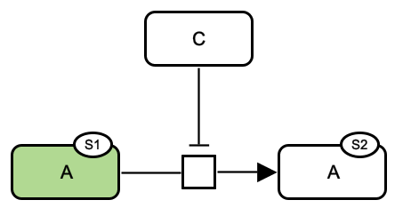

		</td>
		<td style="width:300px; text-align:center;">
			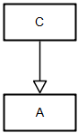
		</td>
	</tr>
	<tr style="font-size:90%">
		<td style="width:400px; text-align:center;">
			<a href="/images/specification/a-inh-i/pd.gml">GML</a>&ensp; &ensp;
			<a href="/images/specification/a-inh-i/pd.sbgn">SBGN-ML</a>&ensp; &ensp;
			<a href="http://web.newteditor.org/?URL=https://www.pd2af.org//images/specification/a-inh-i/pd.sbgn" target="_blank">Newt</a>
		</td>
		<td style="width:300px; text-align:center;">
			<a href="/images/specification/a-inh-i/af.sbgn">SBGN-ML</a>&ensp; &ensp;
			<a href="http://web.newteditor.org/?URL=https://www.pd2af.org//images/specification/a-inh-i/af.sbgn" target="_blank">Newt</a>
		</td>
	</tr>
</table> 
	

   <h4 style="color:black">2.16 PD2AF:A-STI-A</h4>

<table class="rules-table">
	<tr style="font-size:90%">
		<td style="width:400px; text-align:center;">
			
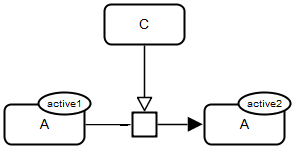

		</td>
		<td style="width:300px; text-align:center;">
			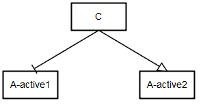
		</td>
	</tr>
	<tr style="font-size:90%">
		<td style="width:400px; text-align:center;">
			<a href="/images/specification/a-sti-a/pd.gml">GML</a>&ensp; &ensp;
			<a href="/images/specification/a-sti-a/pd.sbgn">SBGN-ML</a>&ensp; &ensp;
			<a href="http://web.newteditor.org/?URL=https://www.pd2af.org//images/specification/a-sti-a/pd.sbgn" target="_blank">Newt</a>
		</td>
		<td style="width:300px; text-align:center;">
			<a href="/images/specification/a-sti-a/af.sbgn">SBGN-ML</a>&ensp; &ensp;
			<a href="http://web.newteditor.org/?URL=https://www.pd2af.org//images/specification/a-sti-a/af.sbgn" target="_blank">Newt</a>
		</td>
	</tr>
</table> 
	

   <h4 style="color:black">2.17 PD2AF:A-CAT-A</h4>

<table class="rules-table">
	<tr style="font-size:90%">
		<td style="width:400px; text-align:center;">
			

		</td>
		<td style="width:300px; text-align:center;">
			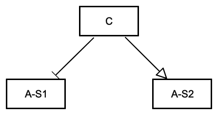
		</td>
	</tr>
	<tr style="font-size:90%">
		<td style="width:400px; text-align:center;">
			<a href="/images/specification/a-cat-a/pd.gml">GML</a>&ensp; &ensp;
			<a href="/images/specification/a-cat-a/pd.sbgn">SBGN-ML</a>&ensp; &ensp;
			<a href="http://web.newteditor.org/?URL=https://www.pd2af.org//images/specification/a-cat-a/pd.sbgn" target="_blank">Newt</a>
		</td>
		<td style="width:300px; text-align:center;">
			<a href="/images/specification/a-cat-a/af.sbgn">SBGN-ML</a>&ensp; &ensp;
			<a href="http://web.newteditor.org/?URL=https://www.pd2af.org//images/specification/a-cat-a/af.sbgn" target="_blank">Newt</a>
		</td>
	</tr>
</table> 

   <h4 style="color:black">2.18 PD2AF:A-NSTI-A</h4>
   
<!--WARNING: Rare or wrong representation of a signalling event.-->
WARNING: Rare or wrong representation of a signalling event.

<table class="rules-table">
	<tr style="font-size:90%">
		<td style="width:400px; text-align:center;">
			
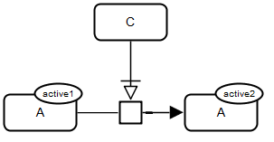

		</td>
		<td style="width:300px; text-align:center;">
			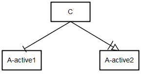
		</td>
	</tr>
	<tr style="font-size:90%">
		<td style="width:400px; text-align:center;">
			<a href="/images/specification/a-nsti-a/pd.gml">GML</a>&ensp; &ensp;
			<a href="/images/specification/a-nsti-a/pd.sbgn">SBGN-ML</a>&ensp; &ensp;
			<a href="http://web.newteditor.org/?URL=https://www.pd2af.org//images/specification/a-nsti-a/pd.sbgn" target="_blank">Newt</a>
		</td>
		<td style="width:300px; text-align:center;">
			<a href="/images/specification/a-nsti-a/af.sbgn">SBGN-ML</a>&ensp; &ensp;
			<a href="http://web.newteditor.org/?URL=https://www.pd2af.org//images/specification/a-nsti-a/af.sbgn" target="_blank">Newt</a>
		</td>
	</tr>
</table> 
	

   <h4 style="color:black">2.19 PD2AF:A-MOD-A</h4>

<table class="rules-table">
	<tr style="font-size:90%">
		<td style="width:400px; text-align:center;">
			
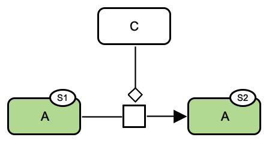

		</td>
		<td style="width:300px; text-align:center;">
			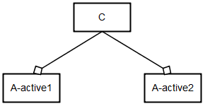
		</td>
	</tr>
	<tr style="font-size:90%">
		<td style="width:400px; text-align:center;">
			<a href="/images/specification/a-mod-a/pd.gml">GML</a>&ensp; &ensp;
			<a href="/images/specification/a-mod-a/pd.sbgn">SBGN-ML</a>&ensp; &ensp;
			<a href="http://web.newteditor.org/?URL=https://www.pd2af.org//images/specification/a-mod-a/pd.sbgn" target="_blank">Newt</a>
		</td>
	<td style="width:300px; text-align:center;">
			<a href="/images/specification/a-mod-a/af.sbgn">SBGN-ML</a>&ensp; &ensp;
			<a href="http://web.newteditor.org/?URL=https://www.pd2af.org//images/specification/a-mod-a/af.sbgn" target="_blank">Newt</a>
		</td>
	</tr>
</table> 
	

   <h4 style="color:black">2.20 PD2AF:A-INH-A</h4>

<table class="rules-table">
	<tr style="font-size:90%">
		<td style="width:400px; text-align:center;">
			
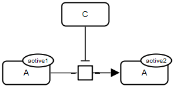

		</td>
		<td style="width:300px; text-align:center;">
			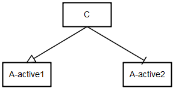
		</td>
	</tr>
	<tr style="font-size:90%">
		<td style="width:400px; text-align:center;">
			<a href="/images/specification/a-inh-a/pd.gml">GML</a>&ensp; &ensp;
			<a href="/images/specification/a-inh-a/pd.sbgn">SBGN-ML</a>&ensp; &ensp;
			<a href="http://web.newteditor.org/?URL=https://www.pd2af.org//images/specification/a-inh-a/pd.sbgn" target="_blank">Newt</a>
		</td>
		<td style="width:300px; text-align:center;">
			<a href="/images/specification/a-inh-a/af.sbgn">SBGN-ML</a>&ensp; &ensp;
			<a href="http://web.newteditor.org/?URL=https://www.pd2af.org//images/specification/a-inh-a/af.sbgn" target="_blank">Newt</a>
		</td>
	</tr>
</table> 

   <h4 style="color:black">2.21 PD2AF:CURM Currency metabolites</h4>

<table class="rules-table">
	<tr style="font-size:90%">
		<td style="width:400px; text-align:center;">
			
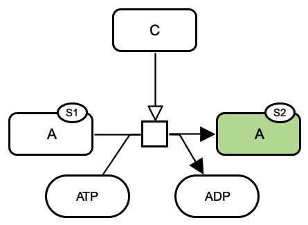

		</td>
		<td style="width:300px; text-align:center;">
			
		</td>
	</tr>
	<tr style="font-size:90%">
		<td style="width:400px; text-align:center;">
			<a href="/images/specification/curm/pd.gml">GML</a>&ensp; &ensp;
			<a href="/images/specification/curm/pd.sbgn">SBGN-ML</a>&ensp; &ensp;
			<a href="http://web.newteditor.org/?URL=https://www.pd2af.org//images/specification/curm/pd.sbgn" target="_blank">Newt</a>
		</td>
		<td style="width:300px; text-align:center;">
			<a href="/images/specification/curm/af.sbgn">SBGN-ML</a>&ensp; &ensp;
			<a href="http://web.newteditor.org/?URL=https://www.pd2af.org//images/specification/curm/af.sbgn" target="_blank">Newt</a>
		</td>
	</tr>
</table> 	

   <h4 style="color:black">2.22 PD2AF:NCURM Noncurrency metabolites</h4>
   
COMMENT: Modified represetnation in Activity Flow: demerging arcs from the logical operator (not available in the current version of the SBGN standard).

<table class="rules-table">
	<tr style="font-size:90%">
		<td style="width:400px; text-align:center;">
			
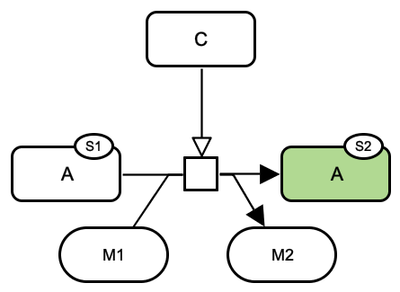

		</td>
		<td style="width:300px; text-align:center;">
			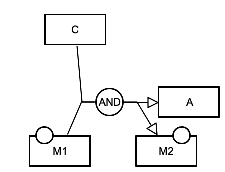
		</td>
	</tr>
	<tr style="font-size:90%">
		<td style="width:400px; text-align:center;">
			<a href="/images/specification/ncurm/pd.gml">GML</a>&ensp; &ensp;
			<a href="/images/specification/ncurm/pd.sbgn">SBGN-ML</a>&ensp; &ensp;
			<a href="http://web.newteditor.org/?URL=https://www.pd2af.org//images/specification/ncurm/pd.sbgn" target="_blank">Newt</a>
		</td>
		<td style="width:300px; text-align:center;">
			<a href="/images/specification/ncurm/af.gml">GML</a>&ensp; &ensp;
			<a href="/images/specification/ncurm/af.sbgn">SBGN-ML</a>&ensp; &ensp;
			<a href="http://web.newteditor.org/?URL=https://www.pd2af.org//images/specification/ncurm/af.sbgn" target="_blank">Newt</a>
		</td>
	</tr>
</table>   

<h4 style="color:black">2.23 PD2AF:A-CATR-A</h4>

<!--WARNING: Rare or wrong representation of a signalling event.-->
WARNING: Rare or wrong representation of a signalling event.

<table class="rules-table">
	<tr style="font-size:90%">
		<td style="width:400px; text-align:center;">
			
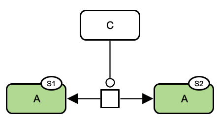

		</td>
		<td style="width:300px; text-align:center;">
			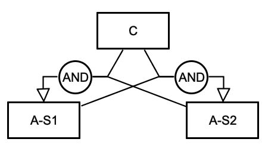
		</td>
	</tr>
	<tr style="font-size:90%">
		<td style="width:400px; text-align:center;">
			<a href="/images/specification/a-catr-a/pd.gml">GML</a>&ensp; &ensp;
			<a href="/images/specification/a-catr-a/pd.sbgn">SBGN-ML</a>&ensp; &ensp;
			<a href="http://web.newteditor.org/?URL=https://www.pd2af.org//images/specification/a-catr-a/pd.sbgn" target="_blank">Newt</a>
		</td>
		<td style="width:300px; text-align:center;">
			<a href="/images/specification/a-catr-a/af.gml">GML</a>&ensp; &ensp;
			<a href="/images/specification/a-catr-a/af.sbgn">SBGN-ML</a>&ensp; &ensp;
			<a href="http://web.newteditor.org/?URL=https://www.pd2af.org//images/specification/a-catr-a/af.sbgn" target="_blank">Newt</a>
		</td>
	</tr>
</table> 

   <h4 style="color:black">2.24 PD2AF:I-CATR-A</h4>
   
<!--WARNING: Rare or wrong representation of a signalling event.-->
WARNING: Rare or wrong representation of a signalling event.

<table class="rules-table">
	<tr style="font-size:90%">
		<td style="width:400px; text-align:center;">
			

		</td>
		<td style="width:300px; text-align:center;">
			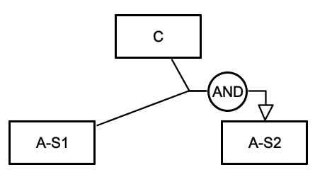
		</td>
	</tr>
	<tr style="font-size:90%">
		<td style="width:400px; text-align:center;">
			<a href="/images/specification/i-catr-a/pd.gml">GML</a>&ensp; &ensp;
			<a href="/images/specification/i-catr-a/pd.sbgn">SBGN-ML</a>&ensp; &ensp;
			<a href="http://web.newteditor.org/?URL=https://www.pd2af.org//images/specification/a-catr-i/pd.sbgn" target="_blank">Newt</a>
		</td>
		<td style="width:300px; text-align:center;">
			<a href="/images/specification/i-catr-a/af.gml">GML</a>&ensp; &ensp;
			<a href="/images/specification/i-catr-a/af.sbgn">SBGN-ML</a>&ensp; &ensp;
			<a href="http://web.newteditor.org/?URL=https://www.pd2af.org//images/specification/a-catr-i/af.sbgn" target="_blank">Newt</a>
		</td>
	</tr>
</table> 

   <h4 style="color:black">2.25 PD2AF:I-INHR-A (AF OUTPUT CORRECTED)</h4>
   
<!--WARNING: Rare or wrong representation of a signalling event.-->
WARNING: Rare or wrong representation of a signalling event.

<table class="rules-table">
	<tr style="font-size:90%">
		<td style="width:400px; text-align:center;">
			
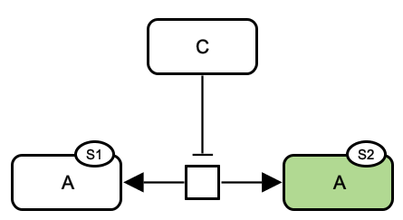

		</td>
		<td style="width:300px; text-align:center;">
			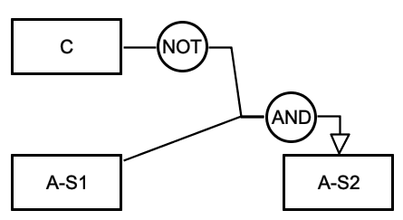
		</td>
	</tr>
	<tr style="font-size:90%">
		<td style="width:400px; text-align:center;">
			<a href="/images/specification/i-inhr-a/af.gml">GML</a>&ensp; &ensp;
			<a href="/images/specification/i-inhr-a/pd.sbgn">SBGN-ML</a>&ensp; &ensp;
			<a href="http://web.newteditor.org/?URL=https://www.pd2af.org//images/specification/i-inhr-a/pd.sbgn" target="_blank">Newt</a>
		</td>
		<td style="width:300px; text-align:center;">
			<a href="/images/specification/i-inhr-a/af.gml">GML</a>&ensp; &ensp;
			<a href="/images/specification/i-inhr-a/af.sbgn">SBGN-ML</a>&ensp; &ensp;
			<a href="http://web.newteditor.org/?URL=https://www.pd2af.org//images/specification/i-inhr-a/af.sbgn" target="_blank">Newt</a>
		</td>
	</tr>
</table> 

## 3. Metabolic reactions

Associated terms: [GO:0008152](https://identifiers.org/quickgo/GO:0008152) metabolic process

   <h4 style="color:black">3.1 PD2AF:M-CAT-M</h4>

<table class="rules-table">
	<tr style="font-size:90%">
		<td style="width:400px; text-align:center;">
			
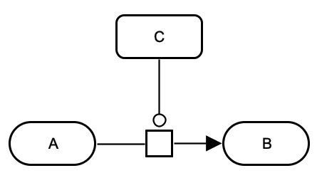

		</td>
		<td style="width:300px; text-align:center;">
			
		</td>
	</tr>
	<tr style="font-size:90%">
		<td style="width:400px; text-align:center;">
			<a href="/images/specification/m-cat-m/pd.gml">GML</a>&ensp; &ensp;
			<a href="/images/specification/m-cat-m/pd.sbgn">SBGN-ML</a>&ensp; &ensp;
			<a href="http://web.newteditor.org/?URL=https://www.pd2af.org//images/specification/m-cat-m/pd.sbgn" target="_blank">Newt</a>
		</td>
		<td style="width:300px; text-align:center;">
			<a href="/images/specification/m-cat-m/af.gml">GML</a>&ensp; &ensp;
			<a href="/images/specification/m-cat-m/af.sbgn">SBGN-ML</a>&ensp; &ensp;
			<a href="http://web.newteditor.org/?URL=https://www.pd2af.org//images/specification/m-cat-m/af.sbgn" target="_blank">Newt</a>
		</td>
	</tr>
</table> 

   <h4 style="color:black">3.2 PD2AF:M-STI-M</h4>

<table class="rules-table">
	<tr style="font-size:90%">
		<td style="width:400px; text-align:center;">
			
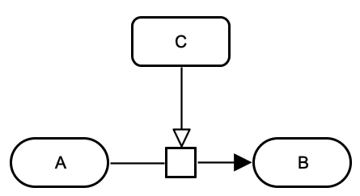

		</td>
		<td style="width:300px; text-align:center;">
			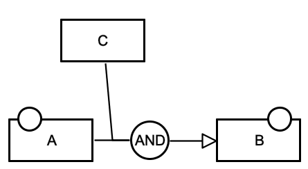
		</td>
	</tr>
	<tr style="font-size:90%">
		<td style="width:400px; text-align:center;">
			<a href="/images/specification/m-sti-m/pd.sbgn">SBGN-ML</a>&ensp; &ensp;
			<a href="http://web.newteditor.org/?URL=https://www.pd2af.org//images/specification/m-sti-m/pd.sbgn" target="_blank">Newt</a>
		</td>
		<td style="width:300px; text-align:center;">
			<a href="/images/specification/m-sti-m/af.gml">GML</a>&ensp; &ensp;
			<a href="/images/specification/m-sti-m/af.sbgn">SBGN-ML</a>&ensp; &ensp;
			<a href="http://web.newteditor.org/?URL=https://www.pd2af.org//images/specification/m-sti-m/af.sbgn" target="_blank">Newt</a>
		</td>
	</tr>
</table> 

   <h4 style="color:black">3.3 PD2AF:M-NSTI-M</h4>
   
<!--WARNING: Rare or wrong representation of a metabolic event.-->
WARNING: Rare or wrong representation of a metabolic event.

<table class="rules-table">
	<tr style="font-size:90%">
		<td style="width:400px; text-align:center;">
			
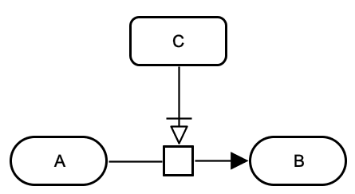

		</td>
		<td style="width:300px; text-align:center;">
			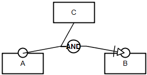
		</td>
	</tr>
	<tr style="font-size:90%">
		<td style="width:400px; text-align:center;">
			<a href="/images/specification/m-nsti-m/pd.sbgn">SBGN-ML</a>&ensp; &ensp;
			<a href="http://web.newteditor.org/?URL=https://www.pd2af.org//images/specification/m-nsti-m/pd.sbgn" target="_blank">Newt</a>
		</td>
		<td style="width:300px; text-align:center;">
			<a href="/images/specification/m-nsti-m/af.gml">GML</a>&ensp; &ensp;
			<a href="/images/specification/m-nsti-m/af.sbgn">SBGN-ML</a>&ensp; &ensp;
			<a href="http://web.newteditor.org/?URL=https://www.pd2af.org//images/specification/m-nsti-m/af.sbgn" target="_blank">Newt</a>
		</td>
	</tr>
</table> 
	

   <h4 style="color:black">3.4 PD2AF:M-MOD-M</h4>
   
<!--WARNING: Rare or wrong representation of a metabolic event.-->
WARNING: Rare or wrong representation of a metabolic event.

<table class="rules-table">
	<tr style="font-size:90%">
		<td style="width:400px; text-align:center;">
			
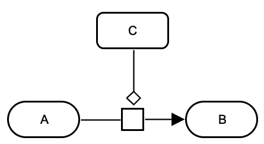

		</td>
		<td style="width:300px; text-align:center;">
			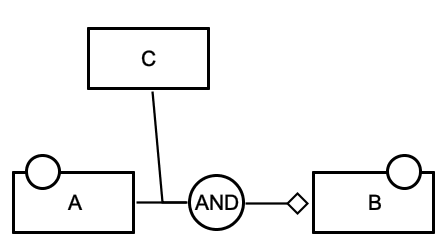
		</td>
	</tr>
	<tr style="font-size:90%">
		<td style="width:400px; text-align:center;">
			<a href="/images/specification/m-mod-m/pd.sbgn">SBGN-ML</a>&ensp; &ensp;
			<a href="http://web.newteditor.org/?URL=https://www.pd2af.org//images/specification/m-mod-m/pd.sbgn" target="_blank">Newt</a>
		</td>
		<td style="width:300px; text-align:center;">
			<a href="/images/specification/m-mod-m/af.gml">GML</a>&ensp; &ensp;
			<a href="/images/specification/m-mod-m/af.sbgn">SBGN-ML</a>&ensp; &ensp;
			<a href="http://web.newteditor.org/?URL=https://www.pd2af.org//images/specification/m-mod-m/af.sbgn" target="_blank">Newt</a>
		</td>
	</tr>
</table> 
	

   <h4 style="color:black">3.5 PD2AF:M-INH-M (AF OUTPUT CORRECTED)</h4>

<table class="rules-table">
	<tr style="font-size:90%">
		<td style="width:400px; text-align:center;">
			
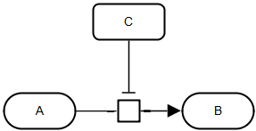

		</td>
		<td style="width:300px; text-align:center;">
			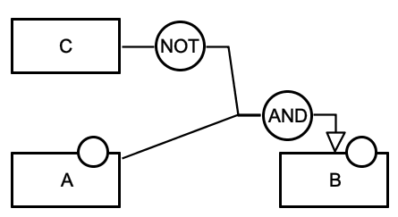
		</td>
	</tr>
	<tr style="font-size:90%">
		<td style="width:400px; text-align:center;">
			<a href="/images/specification/m-inh-m/pd.sbgn">SBGN-ML</a>&ensp; &ensp;
			<a href="http://web.newteditor.org/?URL=https://www.pd2af.org//images/specification/m-inh-m/pd.sbgn" target="_blank">Newt</a>
		</td>
		<td style="width:300px; text-align:center;">
			<a href="/images/specification/m-inh-m/af.gml">GML</a>&ensp; &ensp;
			<a href="/images/specification/m-inh-m/af.sbgn">SBGN-ML</a>&ensp; &ensp;
			<a href="http://web.newteditor.org/?URL=https://www.pd2af.org//images/specification/m-inh-m/af.sbgn" target="_blank">Newt</a>
		</td>
	</tr>
</table> 

   <h4 style="color:black">3.6 PD2AF:M-CATR-M</h4>

<table class="rules-table">
	<tr style="font-size:90%">
		<td style="width:400px; text-align:center;">
			

		</td>
		<td style="width:300px; text-align:center;">
			
		</td>
	</tr>
	<tr style="font-size:90%">
		<td style="width:400px; text-align:center;">
			<a href="/images/specification/m-catr-m/pd.sbgn">SBGN-ML</a>&ensp; &ensp;
			<a href="http://web.newteditor.org/?URL=https://www.pd2af.org//images/specification/m-catr-m/pd.sbgn" target="_blank">Newt</a>
		</td>
		<td style="width:300px; text-align:center;">
			<a href="/images/specification/m-catr-m/af.gml">GML</a>&ensp; &ensp;
			<a href="/images/specification/m-catr-m/af.sbgn">SBGN-ML</a>&ensp; &ensp;
			<a href="http://web.newteditor.org/?URL=https://www.pd2af.org//images/specification/m-catr-m/af.sbgn" target="_blank">Newt</a>
		</td>
	</tr>
</table> 
	

   <h4 style="color:black">3.7 PD2AF:M-INHR-M (AF OUTPUT CORRECTED)</h4>

<table class="rules-table">
	<tr style="font-size:90%">
		<td style="width:400px; text-align:center;">
			

		</td>
		<td style="width:300px; text-align:center;">
			
		</td>
	</tr>
	<tr style="font-size:90%">
		<td style="width:400px; text-align:center;">
			<a href="/images/specification/m-inhr-m/pd.sbgn">SBGN-ML</a>&ensp; &ensp;
			<a href="http://web.newteditor.org/?URL=https://www.pd2af.org//images/specification/m-inhr-m/pd.sbgn" target="_blank">Newt</a>
		</td>
		<td style="width:300px; text-align:center;">
			<a href="/images/specification/m-inhr-m/af.gml">GML</a>&ensp; &ensp;
			<a href="/images/specification/m-inhr-m/af.sbgn">SBGN-ML</a>&ensp; &ensp;
			<a href="http://web.newteditor.org/?URL=https://www.pd2af.org//images/specification/m-inhr-m/af.sbgn" target="_blank">Newt</a>
		</td>
	</tr>
</table> 
   

   
## 4. Empty set (production, degradation, transcription, translation)

This section describes processes with an _empty set_ (source/sink) that represents an external pool of entities and is used when we do not need or wish or have enough information to represent specific entities. For example, for the production of a protein, we do not represent all the amino acids and other metabolites used. 

Associated terms: [SBO:0000179](https://identifiers.org/sbo/SBO:0000179) degradation

	
   <h4 style="color:black">4.1 PD2AF:SS-STI</h4>

<table class="rules-table">
	<tr style="font-size:90%">
		<td style="width:400px; text-align:center;">
			

		</td>
		<td style="width:300px; text-align:center;">
			
		</td>
	</tr>
	<tr style="font-size:90%">
		<td style="width:400px; text-align:center;">
			<a href="/images/specification/es-sti/pd.sbgn">SBGN-ML</a>&ensp; &ensp;
			<a href="http://web.newteditor.org/?URL=https://www.pd2af.org//images/specification/es-sti/pd.sbgn" target="_blank">Newt</a>
		</td>
		<td style="width:300px; text-align:center;">
			<a href="/images/specification/es-sti/af.sbgn">SBGN-ML</a>&ensp; &ensp;
			<a href="http://web.newteditor.org/?URL=https://www.pd2af.org//images/specification/es-sti/af.sbgn" target="_blank">Newt</a>
		</td>
	</tr>
</table> 
	

   <h4 style="color:black">4.2 PD2AF:I-STI-SS</h4>

<table class="rules-table">
	<tr style="font-size:90%">
		<td style="width:400px; text-align:center;">
			

		</td>
		<td style="width:300px; text-align:center;">
			
		</td>
	</tr>
	<tr style="font-size:90%">
		<td style="width:400px; text-align:center;">
			<a href="/images/specification/i-sti-ss/pd.sbgn">SBGN-ML</a>&ensp; &ensp;
			<a href="http://web.newteditor.org/?URL=https://www.pd2af.org//images/specification/i-sti-ss/pd.sbgn" target="_blank">Newt</a>
		</td>
		<td style="width:300px; text-align:center;">
			<a href="/images/specification/i-sti-ss/af.sbgn">SBGN-ML</a>&ensp; &ensp;
			<a href="http://web.newteditor.org/?URL=https://www.pd2af.org//images/specification/i-sti-ss/af.sbgn" target="_blank">Newt</a>
		</td>
	</tr>
</table> 

   <h4 style="color:black">4.3 PD2AF:A-CAT-SS</h4>

<table class="rules-table">
	<tr style="font-size:90%">
		<td style="width:400px; text-align:center;">
			

		</td>
		<td style="width:300px; text-align:center;">
			
		</td>
	</tr>
	<tr style="font-size:90%">
		<td style="width:400px; text-align:center;">
			<a href="/images/specification/a-cat-ss/pd.gml">GML</a>&ensp; &ensp;
			<a href="/images/specification/a-cat-ss/pd.sbgn">SBGN-ML</a>&ensp; &ensp;
			<a href="http://web.newteditor.org/?URL=https://www.pd2af.org//images/specification/a-cat-ss/pd.sbgn" target="_blank">Newt</a>
		</td>
		<td style="width:300px; text-align:center;">
			<a href="/images/specification/a-cat-ss/af.sbgn">SBGN-ML</a>&ensp; &ensp;
			<a href="http://web.newteditor.org/?URL=https://www.pd2af.org//images/specification/a-cat-ss/af.sbgn" target="_blank">Newt</a>
		</td>
	</tr>
</table> 

   <h4 style="color:black">4.4 PD2AF:A-INH-SS</h4>

<table class="rules-table">
	<tr style="font-size:90%">
		<td style="width:400px; text-align:center;">
			

		</td>
		<td style="width:300px; text-align:center;">
			
		</td>
	</tr>
	<tr style="font-size:90%">
		<td style="width:400px; text-align:center;">
			<a href="/images/specification/a-inh-ss/pd.gml">GML</a>&ensp; &ensp;
			<a href="/images/specification/a-inh-ss/pd.sbgn">SBGN-ML</a>&ensp; &ensp;
			<a href="http://web.newteditor.org/?URL=https://www.pd2af.org//images/specification/a-inh-ss/pd.sbgn" target="_blank">Newt</a>
		</td>
		<td style="width:300px; text-align:center;">
			<a href="/images/specification/a-inh-ss/af.sbgn">SBGN-ML</a>&ensp; &ensp;
			<a href="http://web.newteditor.org/?URL=https://www.pd2af.org//images/specification/a-inh-ss/af.sbgn" target="_blank">Newt</a>
		</td>
	</tr>
</table> 
   
   <h4 style="color:black">4.5 PD2AF:SS-TRSCR Trancscription (NEW)</h4>
   
<table class="rules-table">
	<tr style="font-size:90%">
		<td style="width:400px; text-align:center;">
			

		</td>
		<td style="width:300px; text-align:center;">
			
		</td>
	</tr>
	<tr style="font-size:90%">
		<td style="width:400px; text-align:center;">
			<a href="/images/specification/es-trscr/pd.gml">GML</a>&ensp; &ensp;
			<a href="/images/specification/es-trscr/pd.sbgn">SBGN-ML</a>&ensp; &ensp;
			<a href="http://web.newteditor.org/?URL=https://www.pd2af.org//images/specification/es-trscr/pd.sbgn" target="_blank">Newt</a>
		</td>
		<td style="width:300px; text-align:center;">
			<a href="/images/specification/es-trscr/af.gml">GML</a>&ensp; &ensp;
			<a href="/images/specification/es-trscr/af.sbgn">SBGN-ML</a>&ensp; &ensp;
			<a href="http://web.newteditor.org/?URL=https://www.pd2af.org//images/specification/es-trscr/af.sbgn" target="_blank">Newt</a>
		</td>
	</tr>
</table> 

   
   <h4 style="color:black">4.6 PD2AF:SS-TRSL Translation (NEW)</h4> 

<table class="rules-table">
	<tr style="font-size:90%">
		<td style="width:400px; text-align:center;">
			

		</td>
		<td style="width:300px; text-align:center;">
			
		</td>
	</tr>
	<tr style="font-size:90%">
		<td style="width:400px; text-align:center;">
			<a href="/images/specification/es-trsl/pd.gml">GML</a>&ensp; &ensp;
			<a href="/images/specification/es-trsl/pd.sbgn">SBGN-ML</a>&ensp; &ensp;
			<a href="http://web.newteditor.org/?URL=https://www.pd2af.org//images/specification/es-trsl/pd.sbgn" target="_blank">Newt</a>
		</td>
		<td style="width:300px; text-align:center;">
			<a href="/images/specification/es-trsl/af.gml">GML</a>&ensp; &ensp;
			<a href="/images/specification/es-trsl/af.sbgn">SBGN-ML</a>&ensp; &ensp;
			<a href="http://web.newteditor.org/?URL=https://www.pd2af.org//images/specification/es-trsl/af.sbgn" target="_blank">Newt</a>
		</td>
	</tr>
</table> 

  

## 5. Heterocomplex association and dissociation

Associated terms: [SBO:0000177](https://identifiers.org/sbo/SBO:0000177) non-covalent binding, [SBO:0000180](https://identifiers.org/sbo/SBO:0000180) dissociation, [GO:0005488](https://identifiers.org/quickgo/GO:0005488) binding
	
	
   <h4 style="color:black">5.1 PD2AF:COMPL-AS-N Heterocomplex association (named complex)</h4>

<table class="rules-table">
	<tr style="font-size:90%">
		<td style="width:400px; text-align:center;">
			

		</td>
		<td style="width:300px; text-align:center;">
			
		</td>
	</tr>
	<tr style="font-size:90%">
		<td style="width:400px; text-align:center;">
			<a href="/images/specification/compl-as-n/pd.gml">GML</a>&ensp; &ensp;
			<a href="/images/specification/compl-as-n/pd.sbgn">SBGN-ML</a>&ensp; &ensp;
			<a href="http://web.newteditor.org/?URL=https://www.pd2af.org//images/specification/compl-as-n/pd.sbgn" target="_blank">Newt</a>
		</td>
		<td style="width:300px; text-align:center;">
			<a href="/images/specification/compl-as-n/af.gml">GML</a>&ensp; &ensp;
			<a href="/images/specification/compl-as-n/af.sbgn">SBGN-ML</a>&ensp; &ensp;
			<a href="http://web.newteditor.org/?URL=https://www.pd2af.org//images/specification/compl-as-n/af.sbgn" target="_blank">Newt</a>
		</td>
	</tr>
</table> 
	

   <h4 style="color:black">5.2 PD2AF:COMPL-AS Heterocomplex association (unnamed complex)</h4>

<table class="rules-table">
	<tr style="font-size:90%">
		<td style="width:400px; text-align:center;">
			

		</td>
		<td style="width:300px; text-align:center;">
			
		</td>
	</tr>
	<tr style="font-size:90%">
		<td style="width:400px; text-align:center;">
			<a href="/images/specification/compl-as/pd.gml">GML</a>&ensp; &ensp;
			<a href="/images/specification/compl-as/pd.sbgn">SBGN-ML</a>&ensp; &ensp;
			<a href="http://web.newteditor.org/?URL=https://www.pd2af.org//images/specification/compl-as/pd.sbgn" target="_blank">Newt</a>
		</td>
		<td style="width:300px; text-align:center;">
			<a href="/images/specification/compl-as/af.gml">GML</a>&ensp; &ensp;
			<a href="/images/specification/compl-as/af.sbgn">SBGN-ML</a>&ensp; &ensp;
			<a href="http://web.newteditor.org/?URL=https://www.pd2af.org//images/specification/compl-as/af.sbgn" target="_blank">Newt</a>
		</td>
	</tr>
</table> 

   <h4 style="color:black">5.3 PD2AF:COMPL-AS-CAT</h4>

<table class="rules-table">
	<tr style="font-size:90%">
		<td style="width:400px; text-align:center;">
			

		</td>
		<td style="width:300px; text-align:center;">
			
		</td>
	</tr>
	<tr style="font-size:90%">
		<td style="width:400px; text-align:center;">
			<a href="/images/specification/complex_association_regulated/pd.gml">GML</a>&ensp; &ensp;
			<a href="/images/specification/complex_association_regulated/pd.sbgn">SBGN-ML</a>&ensp; &ensp;
			<a href="http://web.newteditor.org/?URL=https://www.pd2af.org//images/specification/complex_association_regulated/pd.sbgn" target="_blank">Newt</a>
		</td>
		<td style="width:300px; text-align:center;">
			<a href="/images/specification/complex_association_regulated/af.gml">GML</a>&ensp; &ensp;
			<a href="/images/specification/complex_association_regulated/af.sbgn">SBGN-ML</a>&ensp; &ensp;
			<a href="http://web.newteditor.org/?URL=https://www.pd2af.org//images/specification/complex_association_regulated/af.sbgn" target="_blank">Newt</a>
		</td>
	</tr>
</table> 
	
	
   <h4 style="color:black">5.4 PD2AF:COMPL-DIS</h4>

<table class="rules-table">
	<tr style="font-size:90%">
		<td style="width:400px; text-align:center;">
			

		</td>
		<td style="width:300px; text-align:center;">
			
		</td>
	</tr>
	<tr style="font-size:90%">
		<td style="width:400px; text-align:center;">
			<a href="/images/specification/complex_dissociation/pd.gml">GML</a>&ensp; &ensp;
			<a href="/images/specification/complex_dissociation/pd.sbgn">SBGN-ML</a>&ensp; &ensp;
			<a href="http://web.newteditor.org/?URL=https://www.pd2af.org//images/specification/complex_dissociation/pd.sbgn" target="_blank">Newt</a>
		</td>
		<td style="width:300px; text-align:center;">
			<a href="/images/specification/complex_dissociation/af.gml">GML</a>&ensp; &ensp;
			<a href="/images/specification/complex_dissociation/af.sbgn">SBGN-ML</a>&ensp; &ensp;
			<a href="http://web.newteditor.org/?URL=https://www.pd2af.org//images/specification/complex_dissociation/af.sbgn" target="_blank">Newt</a>
		</td>
	</tr>
</table> 

  

## 6. Multimerisation

<table>
<tr>
<td style="width: 180px;">X = 2; Y = dimer</td>
<td style="width: 180px;">X = 7; Y = heptamer</td>
<td style="width: 180px;">X = 12; Y = dodecamer</td>
<td style="width: 180px;">X = 17; Y = heptadecamer</td>
</tr>
<tr>
<td style="width: 180px;">X = 3; Y = trimer</td>
<td style="width: 180px;">X = 8; Y = octamer</td>
<td style="width: 180px;">X = 13; Y = tridecamer</td>
<td style="width: 180px;">X = 18; Y = octadecamer</td>
</tr>
<tr>
<td style="width: 180px;">X = 4; Y = tetramer</td>
<td style="width: 180px;">X = 9; Y = nonamer</td>
<td style="width: 180px;">X = 14; Y = tetradecamer</td>
<td style="width: 180px;">X = 19; Y = nonadecamer</td>
</tr>
<tr>
<td style="width: 180px;">X = 5; Y = pentamer</td>
<td style="width: 180px;">X = 10; Y = decamer</td>
<td style="width: 180px;">X = 15; Y = pentadecamer</td>
<td style="width: 180px;">X = 20; Y = eicosamer</td>
</tr>
<tr>
<td style="width: 180px;">X = 6; Y = hexamer</td>
<td style="width: 180px;">X = 11; Y = undecamer</td>
<td style="width: 180px;">X = 16; Y = hexadecamer</td>
<td style="width: 180px;">X = 21; Y = 21-mer</td>
</tr>
</table>

 

<h4 style="color:black">6.1 PD2AF:MULT Multimerisation</h4>

<table class="rules-table">
	<tr style="font-size:90%">
		<td style="width:400px; text-align:center;">
			

		</td>
		<td style="width:300px; text-align:center;">
			
		</td>
	</tr>
	<tr style="font-size:90%">
		<td style="width:400px; text-align:center;">
			<a href="/images/specification/mult/pd.gml">GML</a>&ensp; &ensp;
			<a href="/images/specification/mult/pd.sbgn">SBGN-ML</a>&ensp; &ensp;
			<a href="http://web.newteditor.org/?URL=https://www.pd2af.org//images/specification/mult/pd.sbgn" target="_blank">Newt</a>
		</td>
		<td style="width:300px; text-align:center;">
			<a href="/images/specification/mult/af.sbgn">SBGN-ML</a>&ensp; &ensp;
			<a href="http://web.newteditor.org/?URL=https://www.pd2af.org//images/specification/mult/af.sbgn" target="_blank">Newt</a>
		</td>
	</tr>
</table> 

   <h4 style="color:black">6.2 PD2AF:MULT-STI Multimerisation regulated</h4>

<table class="rules-table">
	<tr style="font-size:90%">
		<td style="width:400px; text-align:center;">
			

		</td>
		<td style="width:300px; text-align:center;">
			
		</td>
	</tr>
	<tr style="font-size:90%">
		<td style="width:400px; text-align:center;">
			<a href="/images/specification/mult-sti/pd.gml">GML</a>&ensp; &ensp;
			<a href="/images/specification/mult-sti/pd.sbgn">SBGN-ML</a>&ensp; &ensp;
			<a href="http://web.newteditor.org/?URL=https://www.pd2af.org//images/specification/mult-sti/pd.sbgn" target="_blank">Newt</a>
		</td>
		<td style="width:300px; text-align:center;">
			<a href="/images/specification/mult-sti/af.gml">GML</a>&ensp; &ensp;
			<a href="/images/specification/mult-sti/af.sbgn">SBGN-ML</a>&ensp; &ensp;
			<a href="http://web.newteditor.org/?URL=https://www.pd2af.org//images/specification/mult-sti/af.sbgn" target="_blank">Newt</a>
		</td>
	</tr>
</table>   

## 7. Translocation and transport
	
Associated terms: [SBO:0000185](https://identifiers.org/sbo/SBO:0000185) tranlocation reaction, [SBO:0000655](https://identifiers.org/quickgo/SBO:0000655) transport reaction, [GO:0006810](https://identifiers.org/quickgo/GO:0006810) transport
	

   <h4 style="color:black">7.1 PD2AF:TRANS</h4>

<table class="rules-table">
	<tr style="font-size:90%">
		<td style="width:400px; text-align:center;">
			

		</td>
		<td style="width:300px; text-align:center;">
			
		</td>
	</tr>
	<tr style="font-size:90%">
		<td style="width:400px; text-align:center;">
			<a href="/images/specification/translocation_1/pd.sbgn">SBGN-ML</a>&ensp; &ensp;
			<a href="http://web.newteditor.org/?URL=https://www.pd2af.org//images/specification/translocation_1/pd.sbgn" target="_blank">Newt</a>
		</td>
		<td style="width:300px; text-align:center;">
			<a href="/images/specification/translocation_1/af.sbgn">SBGN-ML</a>&ensp; &ensp;
			<a href="http://web.newteditor.org/?URL=https://www.pd2af.org//images/specification/translocation_1/af.sbgn" target="_blank">Newt</a>
		</td>
	</tr>
</table> 
	

   <h4 style="color:black">7.1 PD2AF:TRANS-STI</h4>

<table class="rules-table">
	<tr style="font-size:90%">
		<td style="width:400px; text-align:center;">
			

		</td>
		<td style="width:300px; text-align:center;">
			
		</td>
	</tr>
	<tr style="font-size:90%">
		<td style="width:400px; text-align:center;">
			<a href="/images/specification/translocation_2/pd.sbgn">SBGN-ML</a>&ensp; &ensp;
			<a href="http://web.newteditor.org/?URL=https://www.pd2af.org//images/specification/translocation_2/pd.sbgn" target="_blank">Newt</a>
		</td>
		<td style="width:300px; text-align:center;">
			<a href="/images/specification/translocation_2/af.sbgn">SBGN-ML</a>&ensp; &ensp;
			<a href="http://web.newteditor.org/?URL=https://www.pd2af.org//images/specification/translocation_2/af.sbgn" target="_blank">Newt</a>
		</td>
	</tr>
</table>   

## 8. Hidden inhibition

   <h4 style="color:black">8.1 PD2AF:HIDINH1</h4>

<table class="rules-table">
	<tr style="font-size:90%">
		<td style="width:400px; text-align:center;">
			

		</td>
		<td style="width:300px; text-align:center;">
			
		</td>
	</tr>
	<tr style="font-size:90%">
		<td style="width:400px; text-align:center;">
			<a href="/images/specification/hidden_inhibition_1/pd.gml">GML</a>&ensp; &ensp;
			<a href="/images/specification/hidden_inhibition_1/pd.sbgn">SBGN-ML</a>&ensp; &ensp;
			<a href="http://web.newteditor.org/?URL=https://www.pd2af.org//images/specification/hidden_inhibition_1/pd.sbgn" target="_blank">Newt</a>
		</td>
		<td style="width:300px; text-align:center;">
			<a href="/images/specification/hidden_inhibition_1/af.sbgn">SBGN-ML</a>&ensp; &ensp;
			<a href="http://web.newteditor.org/?URL=https://www.pd2af.org//images/specification/hidden_inhibition_1/af.sbgn" target="_blank">Newt</a>
		</td>
	</tr>
</table> 

	
   <h4 style="color:black">8.2 PD2AF:HIDINH2</h4>

This is a combination of rules 8.1 and 2.7

<table class="rules-table">
	<tr style="font-size:90%">
		<td style="width:400px; text-align:center;">
			

		</td>
		<td style="width:300px; text-align:center;">
			
		</td>
	</tr>
	<tr style="font-size:90%">
		<td style="width:400px; text-align:center;">
			<a href="/images/specification/hidden_inhibition_2/pd.gml">GML</a>&ensp; &ensp;
			<a href="/images/specification/hidden_inhibition_2/pd.sbgn">SBGN-ML</a>&ensp; &ensp;
			<a href="http://web.newteditor.org/?URL=https://www.pd2af.org//images/specification/hidden_inhibition_2/pd.sbgn" target="_blank">Newt</a>
		</td>
		<td style="width:300px; text-align:center;">
			<a href="/images/specification/hidden_inhibition_2/af.sbgn">SBGN-ML</a>&ensp; &ensp;
			<a href="http://web.newteditor.org/?URL=https://www.pd2af.org//images/specification/hidden_inhibition_2/af.sbgn" target="_blank">Newt</a>
		</td>
	</tr>
</table>   
